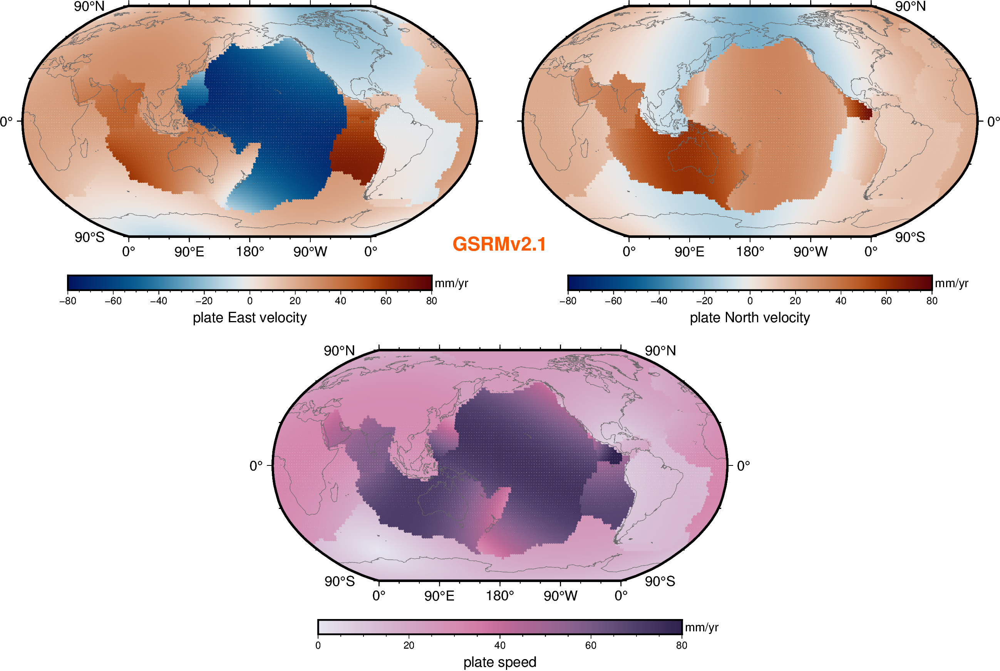
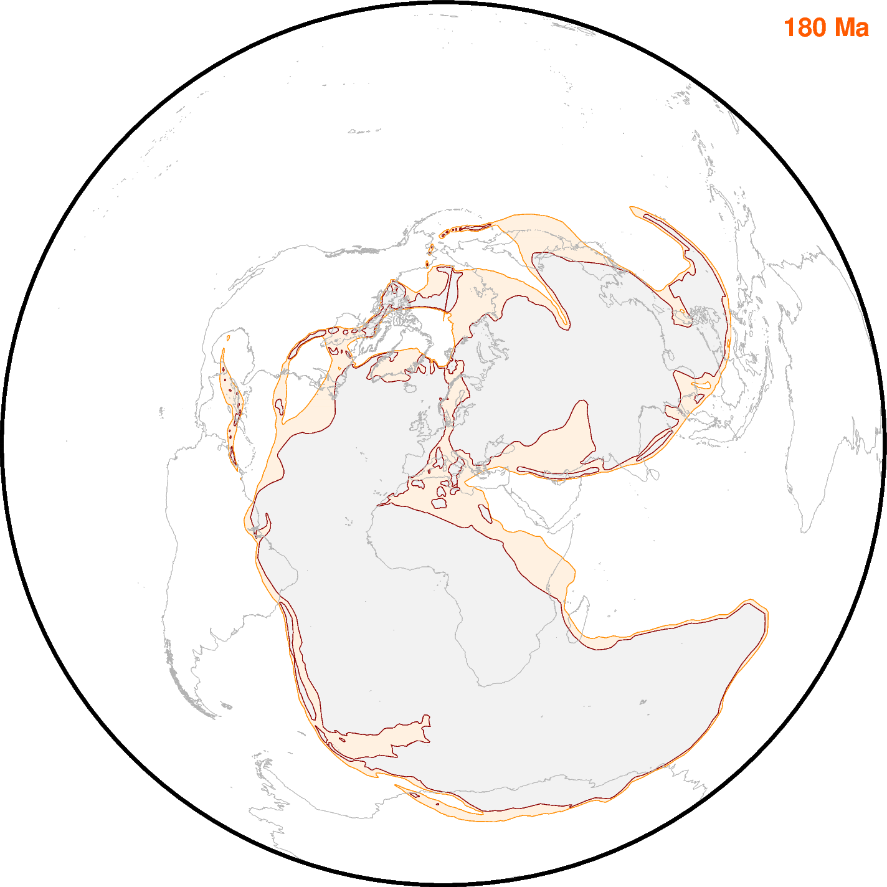
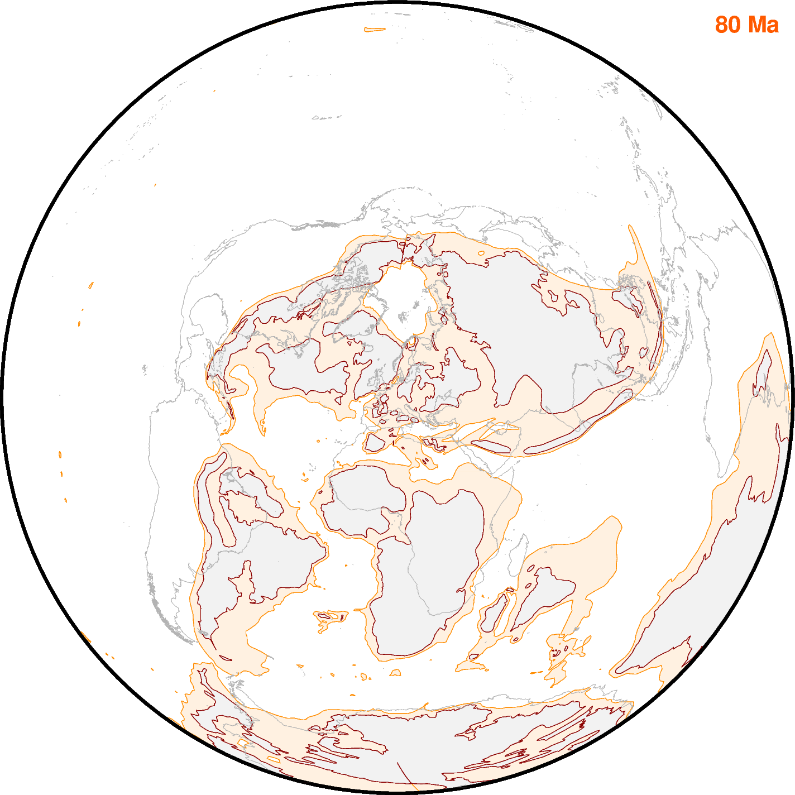
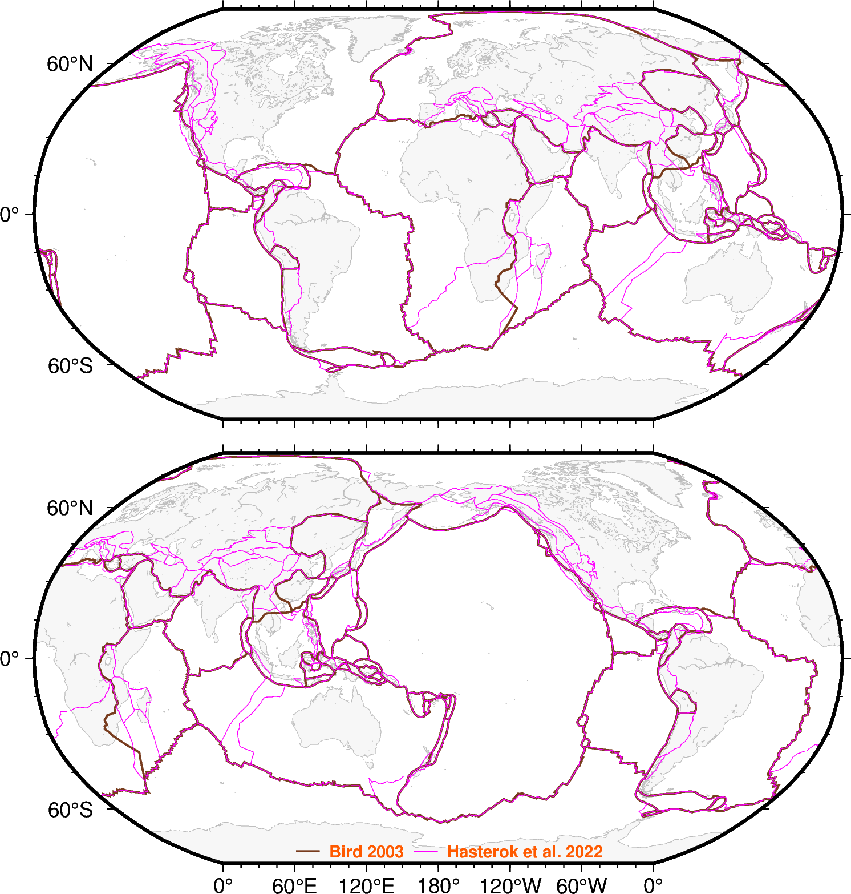

# 020_tectonics

_Recommended versions_: PyGMT 0.19.0, GMT 6.7.0

| **[01_plate_motion](../020_tectonics/01_plate_motion/map_plate_motion.py)** | **[02_paleo_coastlines](../020_tectonics/02_paleo_coastlines/map_paleo_coastlines.py)** | **[03_plate_boundaries](../020_tectonics/03_plate_boundaries/map_plate_boundaries.py)** |
| :---: | :---: | :--: |
|  |   |  |
